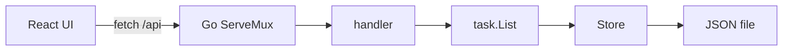

# todo

A task list you drive from the terminal or from a browser, and a browser that shows the Go behind every click.

The React app is a small todo list. Each add, complete, delete, and reload records the HTTP request. The panel on the right shows that request, the Go handler that served it, and a short explanation of the language ideas in that handler.


The UI is published at [themagiche.github.io/learn-go](https://themagiche.github.io/learn-go/). Tasks on that page stay in the browser. The learn panel still shows the Go handler each click would reach. `make dev` is the copy that talks to the API and the JSON file.

## Prerequisites

- Go 1.22 or newer (`go version`)
- Node.js 20 or newer (`node --version`)

## Quick start

```bash
make dev
```

That refreshes the generated Go snippets, starts the API on [http://127.0.0.1:8080](http://127.0.0.1:8080), and starts the UI on [http://127.0.0.1:5173](http://127.0.0.1:5173). Vite proxies `/api` to the Go server. The list is stored in `.data/todo.json`, which is gitignored.

The CLI and the UI share a file when you point them at the same path:

```bash
go run ./cmd/todo list -file .data/todo.json -all
go run ./cmd/todo add -file .data/todo.json "Buy milk"
```

Without `-file`, the CLI uses `~/.todo.json`.

## One binary

```bash
make build
./bin/todo serve -file .data/todo.json
```

`make build` runs the Vite build, then `go build`. The binary embeds `web/dist` with `//go:embed` and serves the UI and the API on `:8080`. `-dev` turns the embedded UI off and enables CORS for local Vite instead.

## Other commands

```bash
make test    # go test -race -cover ./... and vitest
make lint    # gofmt, go vet, tsc --noEmit, eslint
make gen     # rewrite web/src/learn/goSources.ts from the Go source
```

## Architecture



`task.List` owns the rules: add, complete, delete, pending, overdue. `store.Store` is the interface those rules are saved through. `JSONFile` is the implementation that writes the file. The handlers do not open files themselves.

## How the teaching trace works

Every API response sets two headers before it writes the status:

- `X-Go-Handler` — the Go function name, such as `handleCreate`
- `X-Go-Concepts` — concept ids, such as `json,structs,errors`

`Access-Control-Expose-Headers` lists both when `-dev` allows a localhost origin, so a browser on another port can read them. The UI's `apiRequest` copies the headers, the status, the bodies, and the elapsed time into a `Trace`. The learn panel looks up the handler in `web/src/learn/goSources.ts`.

That file is generated. `scripts/gen-go-sources.go` parses this repo with `go/parser` and `go/ast`, slices each function out of the original file, and writes the TypeScript map. `make gen` runs it, and `make dev` / `make build` run it first. Lines that contain `LEARN(concept-id)` are highlighted. The id has to exist in `web/src/learn/concepts.ts`. `go test ./internal/learn/` fails if a comment or a header names an id the glossary does not have.

## CLI

```bash
todo add [-file path] [-due YYYY-MM-DD] "title"
todo list [-file path] [-all]
todo done [-file path] <id>
todo delete [-file path] <id>
todo serve [-file path] [-addr :8080] [-dev]
```

`-due` accepts `YYYY-MM-DD` (end of that local day) or RFC3339. Exit code 2 is bad usage. Exit code 1 is a real failure, such as a missing id.

## curl

The server in these examples is `http://127.0.0.1:8080`.

```bash
# List pending tasks. Add ?all=true to include completed ones.
curl -sS http://127.0.0.1:8080/api/tasks
curl -sS 'http://127.0.0.1:8080/api/tasks?all=true'

# Create a task. due is optional RFC3339.
curl -sS -X POST http://127.0.0.1:8080/api/tasks \
  -H 'Content-Type: application/json' \
  -d '{"title":"Buy milk","due":"2026-10-20T23:59:59Z"}'

# Fetch one task.
curl -sS http://127.0.0.1:8080/api/tasks/1

# Mark it done.
curl -sS -X PATCH http://127.0.0.1:8080/api/tasks/1/done

# Delete it. 204 has an empty body.
curl -sS -D - -X DELETE http://127.0.0.1:8080/api/tasks/1

# Liveness.
curl -sS http://127.0.0.1:8080/api/health
```

Empty titles return 400 `{"error":"title must not be empty"}`. Unknown ids return 404 `{"error":"task not found"}`. A known path with the wrong method returns 405 from the mux.

## Exercises

The lessons page walks the code that is already here. These are the next edits, in the same standard-library style unless a step says otherwise.

1. **Rename a task.** Add `todo edit <id> "new title"` and `PATCH /api/tasks/{id}` with `{"title":"..."}`. Reuse `ErrEmptyTitle` and `ErrNotFound`.
2. **Priority.** Add a `low` / `normal` / `high` field on `Task`, accept it in `POST`, and show it in the list. A new struct tag is the whole JSON contract.
3. **Search.** Honor `?q=` on `GET /api/tasks` by keeping titles that contain the query, case-insensitive.
4. **Sort by due date.** In `List.Pending`, put dated tasks first, soonest first, and undated tasks after them.
5. **SQLite.** Write a `Store` backed by [modernc.org/sqlite](https://pkg.go.dev/modernc.org/sqlite). The handlers should not change. `var _ store.Store = (*SQLite)(nil)` is the compiler's checklist.

## Layout

```
cmd/todo/main.go                 CLI and `serve`
internal/task                    Task, List, and their tests
internal/store                   Store interface and JSONFile
internal/api                     HTTP handlers, middleware, tests
internal/learn                   X-Go-Handler headers and the concept check
web/                             Vite + React + TypeScript UI
.github/workflows/pages.yml      builds the UI and publishes GitHub Pages
scripts/gen-go-sources.go        copies Go functions into the UI
```

The UI has no component kit and no state library. Task state lives in the `useTasks` hook.
